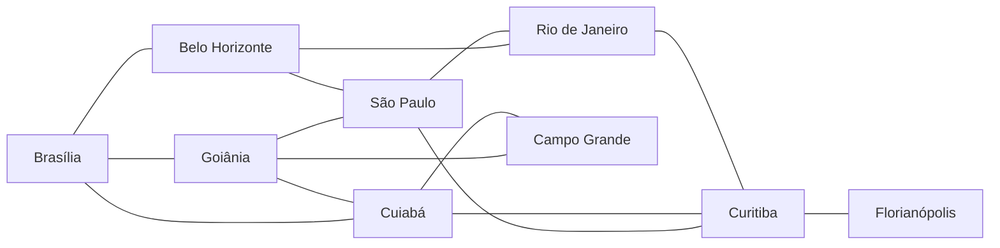

# Solução – Grafos, BFS e DFS

**Disciplina:** Estrutura de Dados II – Ciência da Computação  
**Estudo de caso:** Pane relacionada ao GPS e impactos em voos no Aeroporto de Brasília (simulação didática)

> **Aviso:** Esta atividade é uma simulação computacional. Não representa um modelo de navegação aeronáutica operacional. A notícia motiva o problema; os bloqueios e as rotas são fictícios.

---

## 1. Problema e Objetivo

Uma indisponibilidade de recursos de navegação pode provocar replanejamento operacional. Neste laboratório, modelamos conexões hipotéticas entre cidades como um **grafo não dirigido** e utilizamos **BFS** e **DFS** para encontrar caminhos entre origem e destino.

**Pergunta de pesquisa computacional:**  
> “Dado um grafo não ponderado que representa conexões aéreas hipotéticas, como a remoção de uma ou mais arestas afeta a existência e a qualidade (número de arestas) dos caminhos entre Brasília e Curitiba, e de que forma BFS e DFS se comportam diferentemente nesses cenários de contingência?”

**Objetivos:**
- Modelar vértices e arestas com justificativa
- Construir lista de adjacência
- Implementar BFS e DFS
- Simular bloqueios sem alterar a rede original
- Comparar os algoritmos e discutir limitações

---

## 2. Modelagem do Grafo

### Vértices (9 cidades – acima do mínimo de 7)

| Cidade          | Justificativa                                      |
|-----------------|----------------------------------------------------|
| Brasília        | Origem principal do estudo de caso                 |
| Goiânia         | Conexão próxima a Brasília                         |
| Belo Horizonte  | Corredor importante Centro-Sudeste                 |
| São Paulo       | Hub principal                                      |
| Cuiabá          | Ligação Centro-Oeste                               |
| Rio de Janeiro  | Conexão Sudeste                                    |
| Curitiba        | Destino principal do exercício                     |
| Campo Grande    | Alternativa Centro-Oeste                           |
| Florianópolis   | Folha (só ligada a Curitiba) para testes de isolamento |

### Arestas (conexões hipotéticas justificadas)

- Brasília ↔ Goiânia, Belo Horizonte, Cuiabá  
- Goiânia ↔ São Paulo, Cuiabá, Campo Grande  
- Belo Horizonte ↔ Rio de Janeiro, São Paulo  
- São Paulo ↔ Curitiba, Rio de Janeiro  
- Cuiabá ↔ Campo Grande, Curitiba  
- Rio de Janeiro ↔ Curitiba  
- Curitiba ↔ Florianópolis  

### Diagrama do grafo (Mermaid)



---

## 3. Representação em Python – Lista de Adjacência

```python
GRAFO = {
    "Brasília": ["Goiânia", "Belo Horizonte", "Cuiabá"],
    "Goiânia": ["Brasília", "São Paulo", "Cuiabá", "Campo Grande"],
    "Belo Horizonte": ["Brasília", "Rio de Janeiro", "São Paulo"],
    "São Paulo": ["Goiânia", "Belo Horizonte", "Curitiba", "Rio de Janeiro"],
    "Cuiabá": ["Brasília", "Goiânia", "Campo Grande", "Curitiba"],
    "Rio de Janeiro": ["Belo Horizonte", "São Paulo", "Curitiba"],
    "Curitiba": ["São Paulo", "Cuiabá", "Rio de Janeiro", "Florianópolis"],
    "Campo Grande": ["Goiânia", "Cuiabá"],
    "Florianópolis": ["Curitiba"],
}
```

---

## 4. Implementação de BFS e DFS

### BFS (Breadth-First Search)
- Usa **fila** (`collections.deque`)
- Explora nível a nível
- Em grafo **não ponderado** garante o caminho com **menor número de arestas**

### DFS (Depth-First Search)
- Usa **pilha** (lista + `.pop()`)
- Aprofunda um ramo antes de retroceder
- Encontra **um** caminho (não necessariamente o menor)
- A ordem dos vizinhos influencia o resultado

### Validação de nomes
O programa verifica se origem e destino existem no grafo. Se o usuário digitar um nome inexistente, exibe mensagem de erro e pede novamente.

### Bloqueio de aresta
A função `bloquear_conexao` cria uma **cópia** do grafo e remove a aresta nos dois sentidos. O grafo original permanece intacto.

### Tratamento de casos sem caminho
Quando não existe caminho, as funções retornam `None` e o programa exibe a mensagem:  
`Nenhum caminho encontrado`

---

## 5. Resultados dos Testes

### Experimento A – Rede completa  
**Brasília → Curitiba**

| Algoritmo | Caminho encontrado                                                          | Arestas |
|-----------|-----------------------------------------------------------------------------|---------|
| **BFS**   | Brasília → Cuiabá → Curitiba                                                | **2**   |
| DFS       | Brasília → Goiânia → São Paulo → Belo Horizonte → Rio de Janeiro → Curitiba | 5       |

### Experimento B – Bloqueio Goiânia ↔ São Paulo

| Algoritmo | Caminho encontrado                     | Arestas |
|-----------|----------------------------------------|---------|
| **BFS**   | Brasília → Cuiabá → Curitiba           | **2**   |
| DFS       | Brasília → Goiânia → Cuiabá → Curitiba | 3       |

### Experimento C – Bloqueio adicional Cuiabá ↔ Curitiba

| Algoritmo | Caminho encontrado                                                | Arestas |
|-----------|-------------------------------------------------------------------|---------|
| **BFS**   | Brasília → Belo Horizonte → Rio de Janeiro → Curitiba             | **3**   |
| DFS       | Brasília → Belo Horizonte → Rio de Janeiro → São Paulo → Curitiba | 4       |

### Isolamento de Florianópolis
Bloqueio Curitiba ↔ Florianópolis:

```
BFS: Nenhum caminho encontrado
DFS: Nenhum caminho encontrado
```

---

## 6. Comparação BFS × DFS e Limitações

| Aspecto                   | BFS                                      | DFS                                      |
|---------------------------|------------------------------------------|------------------------------------------|
| Estrutura                 | Fila (FIFO)                              | Pilha (LIFO)                             |
| Caminho encontrado        | Menor número de arestas (não ponderado)  | Qualquer caminho válido                  |
| Influência da ordem       | Baixa                                    | Alta (ordem dos vizinhos muda o caminho) |
| Uso típico                | Menor número de escalas                  | Detectar existência de caminho           |
| Complexidade              | O(V + E)                                 | O(V + E)                                 |

**Limitações da solução:**
- O grafo é **não ponderado**. Não considera tempo de voo, distância, custo ou capacidade.
- Não modela restrições operacionais reais (horários, slots, NOTAMs etc.).
- DFS pode retornar caminhos longos se a ordem dos vizinhos for desfavorável.
- O resultado **não pode** ser usado para orientar um voo real — é apenas didático.

---

## 7. Como executar

```bash
python solucao_grafos_BFS_DFS.py
```

O programa:
1. Mostra a lista de adjacência
2. Executa automaticamente os experimentos A, B, C e o teste de isolamento
3. Entra no modo interativo (origem/destino + opção de bloqueio)

### Exemplo de saída do programa

```
============================================================
  SIMULAÇÃO DE ROTAS AÉREAS – BFS e DFS
  Estudo de caso: pane relacionada ao GPS (didático)
============================================================

=== Lista de Adjacência ===
  Belo Horizonte: [Brasília, Rio de Janeiro, São Paulo]
  Brasília: [Goiânia, Belo Horizonte, Cuiabá]
  Campo Grande: [Goiânia, Cuiabá]
  Cuiabá: [Brasília, Goiânia, Campo Grande, Curitiba]
  Curitiba: [São Paulo, Cuiabá, Rio de Janeiro, Florianópolis]
  Florianópolis: [Curitiba]
  Goiânia: [Brasília, São Paulo, Cuiabá, Campo Grande]
  Rio de Janeiro: [Belo Horizonte, São Paulo, Curitiba]
  São Paulo: [Goiânia, Belo Horizonte, Curitiba, Rio de Janeiro]

============================================================
  TESTES AUTOMÁTICOS
============================================================

--- Cenário: Rede completa (sem bloqueios) ---
Origem: Brasília  |  Destino: Curitiba
BFS: Brasília → Cuiabá → Curitiba  (2 arestas)
DFS: Brasília → Goiânia → São Paulo → Belo Horizonte → Rio de Janeiro → Curitiba  (5 arestas)

--- Cenário: Bloqueio: Goiânia ↔ São Paulo ---
Origem: Brasília  |  Destino: Curitiba
BFS: Brasília → Cuiabá → Curitiba  (2 arestas)
DFS: Brasília → Goiânia → Cuiabá → Curitiba  (3 arestas)

--- Cenário: Bloqueio adicional: Cuiabá ↔ Curitiba ---
Origem: Brasília  |  Destino: Curitiba
BFS: Brasília → Belo Horizonte → Rio de Janeiro → Curitiba  (3 arestas)
DFS: Brasília → Belo Horizonte → Rio de Janeiro → São Paulo → Curitiba  (4 arestas)

--- Cenário: Caminho até Florianópolis ---
Origem: Brasília  |  Destino: Florianópolis
BFS: Brasília → Cuiabá → Curitiba → Florianópolis  (3 arestas)
DFS: Brasília → Goiânia → São Paulo → Belo Horizonte → Rio de Janeiro → Curitiba → Florianópolis  (6 arestas)

--- Cenário: Bloqueio Curitiba ↔ Florianópolis (isola a folha) ---
Origem: Brasília  |  Destino: Florianópolis
BFS: Nenhum caminho encontrado
DFS: Nenhum caminho encontrado

============================================================
  MODO INTERATIVO
============================================================
Vértices disponíveis: Belo Horizonte, Brasília, Campo Grande, Cuiabá, Curitiba, Florianópolis, Goiânia, Rio de Janeiro, São Paulo
(Digite 'sair' a qualquer momento para encerrar)
```

---

## 8. Estrutura dos arquivos

```
.
├── solucao_grafos.py   # Código completo e executável
└── README.md           # Este documento
```

---

## 9. Questões para reflexão

**1. Por que um grafo representa melhor a rede de conexões do que uma árvore binária?**  
Porque um grafo permite **ciclos** e **múltiplos caminhos** entre os mesmos vértices. Uma árvore binária é acíclica e tem no máximo um caminho entre qualquer par de nós, o que não modela adequadamente uma rede de voos (onde existem rotas alternativas e ciclos).

**2. Em qual condição BFS encontra o menor caminho? O que significa “menor”?**  
BFS encontra o menor caminho em **grafos não ponderados** (todas as arestas têm o mesmo “custo”). “Menor” significa o caminho com a **menor quantidade de arestas** (menos escalas), não necessariamente menor distância geográfica ou menor tempo.

**3. Por que DFS pode retornar um caminho diferente de BFS?**  
Porque DFS aprofunda um ramo antes de explorar os outros. A ordem em que os vizinhos estão armazenados na lista de adjacência determina qual caminho é encontrado primeiro. BFS, por explorar nível a nível, sempre encontra um caminho com o menor número de arestas.

**4. O que ocorre se não utilizarmos um conjunto de visitados?**  
Em grafos com ciclos, o algoritmo pode entrar em **loop infinito**, revisitando os mesmos vértices indefinidamente e nunca terminando.

**5. Quais informações adicionais seriam necessárias para avaliar tempo ou custo de uma rota?**  
Seriam necessários **pesos nas arestas** (tempo de voo, distância, custo de combustível, taxa de aeroporto etc.) e o uso de algoritmos de caminho mínimo ponderado, como Dijkstra ou Bellman-Ford.s

**6. Por que o resultado do algoritmo não pode ser usado para orientar um voo real?**  
Porque o modelo é uma **simplificação didática**. Ele não considera restrições operacionais (horários, slots, condições meteorológicas, NOTAMs, capacidade de aeroportos, regras de tráfego aéreo etc.). Servir de rota real seria inseguro e inadequado.

---

## 10. Referências

- GOMES, Paulo César Rodacki. *Grafos: conceitos fundamentais, algoritmos e aplicações*. Blumenau: Editora IFC, 2022.
- G1 DISTRITO FEDERAL. Pane em GPS afeta voos da Azul no Aeroporto de Brasília; passageiros reclamam de atrasos. 22 set. 2026.

---
