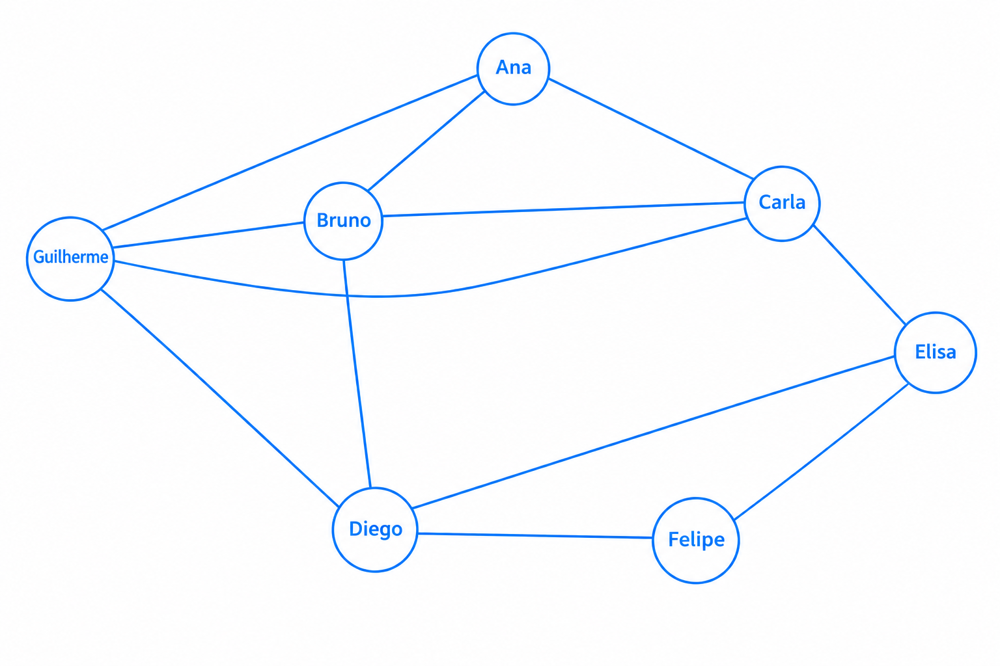

# Caderno do Estudante
# Projeto ConectaUDF: redes sociais com grafos
**Disciplina:** Algoritmos / Matemática Discreta / Ciência de Dados

## 1. O desafio
Você faz parte da equipe que analisa a rede social fictícia **ConectaUDF**. Sua missão é representar as amizades em um grafo, realizar cálculos e usar Python para interpretar a estrutura da rede.

## 2. Conceitos essenciais
- **Vértice (ou nó):** representa um usuário.
- **Aresta:** representa uma amizade entre dois usuários.
- **Grau:** quantidade de conexões diretas de um usuário.
- **Caminho:** sequência de usuários em que cada par consecutivo está conectado.
- **Densidade:** proporção entre as amizades existentes e todas as amizades possíveis.

Neste projeto, a amizade é recíproca. Portanto, usamos um **grafo não direcionado**.

## 3. Conheça os usuários
| Código | Usuário |
|---|---|
| A | Ana |
| B | Bruno |
| C | Carla |
| D | Diego |
| E | Elisa |
| F | Felipe |
| G | Guilherme |

As amizades são:
1. Ana — Bruno
2. Ana — Carla
3. Bruno — Carla
4. Bruno — Diego
5. Carla — Elisa
6. Diego — Elisa
7. Diego — Felipe
8. Elisa — Felipe
9. Ana — Guilherme
10. Bruno — Guilherme
11. Carla — Guilherme
12. Diego — Guilherme

## 4. Passo a passo: desenhe o grafo
1. Desenhe sete círculos, um para cada usuário.
2. Escreva o nome de cada pessoa dentro do círculo.
3. Para cada amizade da lista, desenhe uma linha entre os dois usuários.
4. Não desenhe duas linhas para a mesma amizade.
5. Confira se todas as doze amizades aparecem.



## 5. Passo a passo: calcule o grau
Conte quantas linhas chegam a cada círculo. Registre o resultado.

| Usuário | Amigos diretos | Grau |
|---|---|---:|
| Ana | Bruno, Carla, Guilherme | 3 |
| Bruno | Ana, Carla, Diego, Guilherme | 4 |
| Carla | Ana, Bruno, Elisa, Guilherme | 4 |
| Diego | Bruno, Elisa, Felipe, Guilherme | 4 |
| Elisa | Carla, Diego, Felipe | 3 |
| Felipe | Diego, Elisa | 2 |
| Guilherme | Ana, Bruno, Carla, Diego | 4 |
| **Total da soma dos graus** | | **24** |

**Pergunta 1:** quem tem mais conexões diretas?  
**Resposta:** Bruno, Carla, Diego e Guilherme, cada um com grau 4.

## 6. Passo a passo: calcule o número de amizades
Some todos os graus. Como cada amizade conecta dois usuários, cada aresta é contada duas vezes.

**Fórmula:**  
`Número de arestas = soma dos graus ÷ 2`

1. Soma dos graus: `24`
2. Divida por 2: `12`
3. Quantas amizades existem no grafo? **12 amizades.**

## 7. Passo a passo: calcule a densidade
A densidade compara as amizades existentes com o total de amizades possíveis.

Para um grafo simples não direcionado:

`D = 2 × E / (V × (V − 1))`

Em que:
- `D` = densidade;
- `E` = número de arestas;
- `V` = número de vértices.

Substitua os valores:
`D = 2 × 12 / (7 × (7 − 1))`

`D = 24 / (7 × 6)`

`D = 24 / 42 ≈ 0,5714`

Resultado percentual: **57,14%**

**Interprete:** a rede tem poucas ou muitas das conexões possíveis? Explique com suas palavras.

**Resposta:** a rede tem poucas conexões possíveis, o que corresponde a uma densidade de 57,14%. Portanto, podee até não ser uma rede "cheia" mas possui apenas 12 conexões sendo que o maximo que pode alcançar com 7 pessoas e 21, faltando apenas 9 ligações restantes, sendo nem o dobro da quantidade de pessoas.

## 8. Passo a passo: represente o grafo em Python
A lista de adjacência registra, para cada usuário, os nomes de seus amigos. Digite o código em Python (por exemplo, no Google Colab ou em outro ambiente disponível).

```python
rede = {
    "Ana": ["Bruno", "Carla", "Guilherme"],
    "Bruno": ["Ana", "Carla", "Diego", "Guilherme"],
    "Carla": ["Ana", "Bruno", "Elisa", "Guilherme"],
    "Diego": ["Bruno", "Elisa", "Felipe", "Guilherme"],
    "Elisa": ["Carla", "Diego", "Felipe"],
    "Felipe": ["Diego", "Elisa"],
    "Guilherme": ["Ana", "Bruno", "Carla", "Diego"]
}

# Quantidade de usuarios
n = len(rede)

# Calcule o grau de cada usuario
for usuario, amigos in rede.items():
    print(usuario, "tem grau", len(amigos))

# A soma dos graus conta cada amizade duas vezes
soma_graus = sum(len(amigos) for amigos in rede.values())
arestas = soma_graus // 2

print("Total de usuarios:", n)
print("Soma dos graus:", soma_graus)
print("Total de amizades:", arestas)

# Densidade do grafo
densidade = (2 * arestas) / (n * (n - 1))
print(f"Densidade: {densidade:.2%}")
```

### Entenda o código
1. `rede` guarda os usuários e suas listas de amigos.
2. `len(rede)` conta os usuários.
3. `len(amigos)` calcula o grau de cada usuário.
4. `sum(...)` soma os graus.
5. `// 2` divide a soma por dois para contar cada amizade uma única vez.
6. A fórmula final calcula a densidade.

### Resultado esperado do código

```text
Ana tem grau 3
Bruno tem grau 4
Carla tem grau 4
Diego tem grau 4
Elisa tem grau 3
Felipe tem grau 2
Guilherme tem grau 4
Total de usuarios: 7
Soma dos graus: 24
Total de amizades: 12
Densidade: 57.14%
```

## 9. Passo a passo: encontre um caminho
Encontre um caminho de Ana até Felipe. Cada passagem por uma linha corresponde a uma aresta.

**Exemplo de caminho:**  
`Ana → Bruno → Diego → Felipe`

- Quantas arestas há no caminho? **3 arestas.**
- Você encontrou outro caminho com a mesma quantidade de arestas? Qual?

**Resposta:** sim. `Ana → Carla → Elisa → Felipe` também possui 3 arestas.

## 10. Desafio em grupo
Amplie a rede social:
1. Adicione pelo menos quatro usuários fictícios.
2. Crie no mínimo cinco novas amizades.
3. Atualize a lista de adjacência no Python.
4. Recalcule os graus, o total de arestas e a densidade.
5. Compare a densidade antes e depois da ampliação.
6. Identifique os usuários com mais conexões.
7. Explique como a rede poderia recomendar uma nova amizade.

## 11. Entrega
Entregue:
- desenho do grafo;
- tabela com os graus;
- cálculos de arestas e densidade;
- código Python executável;
- respostas às perguntas e breve conclusão.

### Conclusão
O grafo ConectaUDF representa uma rede social com sete usuários e doze amizades. Bruno, Carla, Diego e Guilherme possuem o maior grau, com quatro conexões cada. A soma dos graus é 24; dividindo esse valor por dois, obtemos 12 amizades. A densidade é de 57,14%, indicando que pouco mais da metade das conexões possíveis está presente na rede. O uso de grafos e Python permite representar e analisar as relações entre os usuários.

## 12. Pergunta de reflexão
Duas pessoas ainda não são amigas, mas têm três amigos em comum. Como essa informação poderia ser usada para sugerir uma nova conexão? Quais cuidados de privacidade devem ser considerados ao analisar redes sociais?

**Resposta sugerida:** a plataforma poderia recomendar que essas pessoas se conectassem porque têm amigos em comum. Porém, deve respeitar a privacidade dos usuários, proteger seus dados e permitir que controlem como suas informações são usadas.
